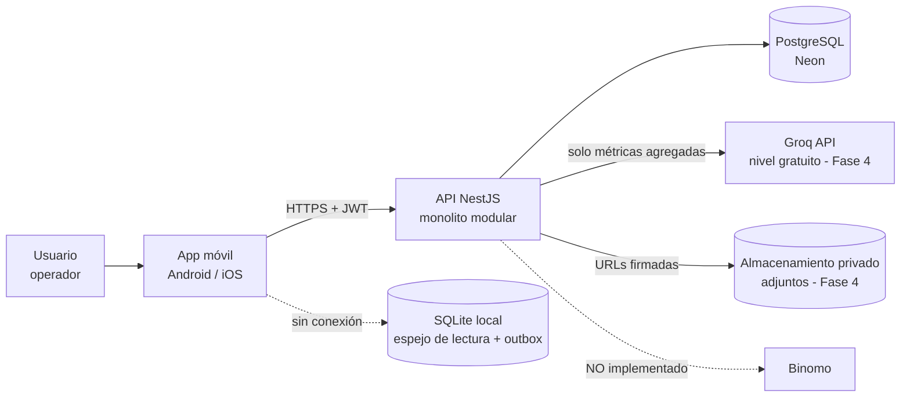
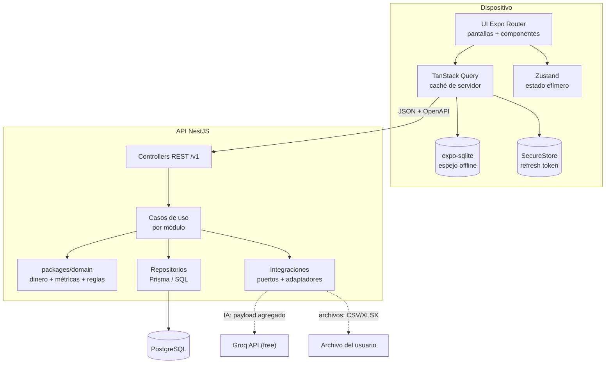
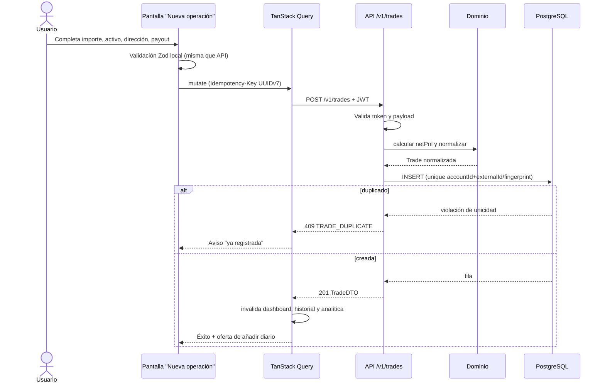

# 04 — Arquitectura de software

## 1. Principios

1. **Un monolito modular**, no microservicios. Límites claros por módulo, un solo despliegue.
2. **Clean Architecture** con regla de dependencia: presentación → aplicación → dominio; la
   infraestructura implementa puertos del dominio, nunca al revés.
3. **El dominio no conoce a Binomo, ni a Prisma, ni a HTTP, ni a React Native.**
4. **Una sola fuente de verdad para los cálculos financieros** (`packages/domain`).
5. **Explícito antes que implícito:** dinero en enteros, tiempo en UTC, saldo confirmado vs
   calculado, muestra mínima en cada métrica.
6. **Seguridad y privacidad por defecto**, con aislamiento por usuario en cada consulta.
7. **Simple primero:** sin caché distribuida, colas ni event sourcing hasta que exista necesidad real.

## 2. Vista de contexto



Relaciones prohibidas por diseño:

- La app móvil **nunca** llama a Binomo ni a un proveedor de IA directamente.
- La app móvil **nunca** guarda claves de IA.
- La API **nunca** recibe credenciales, cookies o sesiones de Binomo.

## 3. Vista de contenedores



## 4. Monorepo y estructura de carpetas (entregable 8)

> Estructura **objetivo**. El árbol realmente creado en M1 está en el `README.md` de la raíz;
> las carpetas se irán completando en los hitos M2–M6.

```
panel-trading/
├─ apps/
│  ├─ api/                          # NestJS
│  └─ mobile/                       # Expo / React Native
├─ packages/
│  ├─ domain/                       # Lógica pura, sin I/O
│  │  └─ src/
│  │     ├─ money/                  # Money, redondeo, puntos básicos
│  │     ├─ trades/                 # Entidad, resultado, validaciones
│  │     ├─ analytics/              # Métricas, series, agrupaciones
│  │     ├─ balance/                # Saldo calculado y conciliación
│  │     └─ feedback/               # Reglas de evidencia y muestra mínima
│  ├─ contracts/                    # Zod + tipos de request/response
│  │  └─ src/{auth,trades,accounts,transactions,analytics,feedback,common}
│  ├─ config/                       # ESLint, Prettier, tsconfig base
│  └─ testing/                      # Builders y fixtures compartidos
├─ docs/                            # Esta documentación
├─ docker/                          # docker-compose.yml, Dockerfile API
├─ .github/workflows/               # CI, EAS, migraciones
├─ package.json                     # Scripts raíz
├─ pnpm-workspace.yaml
├─ turbo.json
├─ .env.example
└─ CHANGELOG.md
```

### 4.1 API — estructura interna

```
apps/api/
├─ src/
│  ├─ main.ts
│  ├─ app.module.ts
│  ├─ common/
│  │  ├─ filters/                   # Excepciones → Problem Details
│  │  ├─ guards/                    # JWT, scopes, throttling
│  │  ├─ interceptors/              # Logging, auditoría, serialización
│  │  ├─ decorators/                # @CurrentUser, @IdempotencyKey
│  │  └─ errors/                    # Catálogo de errores de dominio
│  ├─ config/                       # Validación de entorno (Zod)
│  ├─ database/
│  │  ├─ prisma.service.ts
│  │  ├─ prisma/schema.prisma
│  │  └─ migrations/
│  ├─ modules/
│  │  ├─ auth/
│  │  ├─ users/
│  │  ├─ trading-accounts/
│  │  ├─ trades/
│  │  ├─ imports/
│  │  ├─ transactions/
│  │  ├─ balance/
│  │  ├─ analytics/
│  │  ├─ journal/
│  │  ├─ feedback/
│  │  ├─ notifications/
│  │  ├─ reports/
│  │  ├─ settings/
│  │  └─ health/
│  ├─ integrations/
│  │  ├─ trading-platform/
│  │  │  ├─ trading-platform.port.ts
│  │  │  ├─ manual.adapter.ts
│  │  │  ├─ file-import.adapter.ts
│  │  │  └─ binomo.adapter.ts       # capabilities() = false, sin red
│  │  ├─ ai/
│  │  │  ├─ ai.port.ts
││  │     └─ groq.adapter.ts         # Fase 4, nivel gratuito
│  │  └─ storage/
│  │     ├─ storage.port.ts
│  │     └─ s3.adapter.ts           # Fase 4
│  └─ jobs/                         # Cron de resúmenes (Fase 5)
└─ test/                            # e2e, fixtures, testcontainers
```

Cada módulo de `modules/` sigue la misma forma:

```
<module>/
├─ <module>.controller.ts     # Presentación (HTTP), sin lógica de negocio
├─ <module>.service.ts        # Casos de uso / orquestación
├─ <module>.repository.ts     # Puerto de persistencia (interfaz)
├─ <module>.prisma-repo.ts    # Implementación Prisma
├─ dto/                       # Derivados de packages/contracts
└─ __tests__/
```

### 4.2 Móvil — estructura interna

```
apps/mobile/
├─ app/                              # Expo Router (solo rutas y layouts)
│  ├─ _layout.tsx                    # Providers, tema, i18n, gate de sesión
│  ├─ (auth)/
│  │  ├─ login.tsx
│  │  ├─ registro.tsx
│  │  └─ desbloqueo.tsx              # PIN / biometría (Fase 5)
│  ├─ (app)/
│  │  ├─ (tabs)/
│  │  │  ├─ index.tsx                # Dashboard
│  │  │  ├─ operaciones.tsx          # Historial
│  │  │  ├─ analitica.tsx
│  │  │  ├─ diario.tsx
│  │  │  └─ ajustes.tsx
│  │  ├─ operaciones/
│  │  │  ├─ nueva.tsx
│  │  │  └─ [id].tsx                 # Detalle + edición + diario
│  │  ├─ importar/
│  │  │  ├─ index.tsx                # Selección de archivo
│  │  │  ├─ mapeo.tsx                # Mapeo de columnas
│  │  │  └─ revision.tsx             # Vista previa y confirmación
│  │  ├─ finanzas/
│  │  │  ├─ index.tsx
│  │  │  └─ movimiento.tsx
│  │  └─ feedback/
│  │     └─ [id].tsx
│  └─ +not-found.tsx
├─ src/
│  ├─ features/<feature>/            # Componentes, hooks y api por dominio
│  ├─ components/ui/                 # Botones, cards, inputs, sheets, estados
│  ├─ components/charts/             # Envoltorio de gráficos (sustituible)
│  ├─ design/
│  │  ├─ tokens.ts                   # Colores, espaciado, tipografía, radios
│  │  └─ theme.ts                    # Claro / oscuro
│  ├─ lib/
│  │  ├─ api/client.ts               # fetch tipado + refresh + errores
│  │  ├─ api/query-client.ts
│  │  ├─ storage/                    # SecureStore, preferencias
│  │  ├─ db/                         # Esquema SQLite, repos, migraciones
│  │  ├─ notifications/
│  │  └─ i18n/                       # es.json, configuración
│  └─ config/
├─ app.config.ts
├─ eas.json
└─ assets/
```

## 5. Capas y reglas de dependencia

| Capa | Puede depender de | No puede depender de |
|---|---|---|
| Dominio (`packages/domain`) | Nada externo (solo utilidades puras) | Prisma, NestJS, React, HTTP, SQLite |
| Contratos (`packages/contracts`) | Zod | Dominio interno de la API |
| Aplicación (services/use cases) | Dominio, contratos, puertos | Detalles de Prisma o HTTP |
| Infraestructura (repos, adaptadores) | Dominio, Prisma, SDKs | Presentación |
| Presentación (controllers, pantallas) | Aplicación, contratos, dominio (solo lectura) | Prisma directamente |

Regla de CI: `packages/domain` no puede importar `@nestjs/*`, `express`, `react`, `react-native`,
`@prisma/client` ni `expo-*`. Se verifica con una regla de ESLint (`no-restricted-imports`).

## 6. Módulos y responsabilidades (entregable 9)

| Módulo | Responsabilidad | Entidades principales | Depende de |
|---|---|---|---|
| `auth` | Registro, login, refresh rotativo, revocación por dispositivo | `User`, `RefreshSession` | users, settings |
| `users` | Perfil, zona horaria, locale, borrado/exportación de datos | `User` | — |
| `trading-accounts` | Cuentas real/demo, divisa, saldo inicial y confirmado | `TradingAccount` | auth |
| `trades` | CRUD de operaciones, validación, dedupe, filtros y paginación | `Trade` | accounts, domain |
| `imports` | Carga de archivo, detección, mapeo, previsualización, lote transaccional | `ImportBatch`, `ImportRowError` | trades, accounts |
| `transactions` | Depósitos, retiros, comisiones, ajustes, bonos | `Transaction` | accounts |
| `balance` | Saldo calculado, conciliación contra confirmado, historial de capital | `BalanceSnapshot` | trades, transactions |
| `analytics` | Métricas, series temporales, agrupaciones por activo/hora/estrategia | Ninguna (derivadas) | trades, domain |
| `journal` | Diario por operación: estrategia, emoción, disciplina, errores, aprendizaje | `JournalEntry` | trades |
| `feedback` | Generación, validación y almacenamiento de informes de IA | `FeedbackReport` | analytics, ai |
| `notifications` | Reglas de alerta, eventos, preferencias, resúmenes | `AlertRule`, `AlertEvent` | trades, balance |
| `reports` | Exportación CSV/PDF de operaciones y resúmenes | — | trades, analytics |
| `settings` | Tema, idioma, divisa, límites de riesgo, privacidad | `UserSettings` | — |
| `health` | Estado del servicio y de la base de datos | — | — |

Dependencias permitidas: `trades → accounts`, `analytics → trades`, `feedback → analytics`,
`balance → trades + transactions`. **Prohibidas las dependencias circulares** (se validan con
`madge` en CI).

## 7. Contratos de API

- **Prefijo y versión:** `/v1/...`; cambios incompatibles → `/v2`, nunca ruptura silenciosa.
- **Recursos:** `GET/POST/PATCH/DELETE` sobre colecciones; borrado lógico con `DELETE`.
- **Paginación:** por cursor (`?cursor=...&limit=50`, máx. 200). Nunca offset en listados grandes.
- **Filtros:** query params tipados y validados por Zod (`from`, `to`, `accountId`, `asset`,
  `result`, `minStake`, `maxStake`, `q`, `accountType`).
- **Fechas:** ISO 8601 en UTC (`2026-11-21T18:30:00.000Z`). La zona horaria del usuario va aparte.
- **Errores:** formato estable `{ statusCode, code, message, details?, requestId }`; `code` es un
  identificador de dominio (`TRADE_DUPLICATE`, `BALANCE_MISMATCH_REQUIRES_REASON`, …).
- **Idempotencia:** `Idempotency-Key` obligatorio en `POST /v1/trades` y `POST /v1/imports`.
- **Autorización:** JWT de acceso en `Authorization: Bearer`; el `userId` **siempre** sale del token,
  nunca del body o de un query param. Cada petición autenticada revalida la sesión en base de datos
  (no revocada y sin caducar), de forma que cerrar sesión, cambiar la contraseña o detectar reuso de
  refresh invalida el acceso al instante y no al expirar el JWT.
- **OpenAPI:** generado por NestJS y publicado en `/v1/docs` en entornos no productivos.
- **Límites:** 100 req/min por usuario en lectura; 20 req/min en escritura; 10 req/hora en feedback.

### 7.1 Ejemplos de recursos

```
POST   /v1/auth/register
POST   /v1/auth/login
POST   /v1/auth/refresh
POST   /v1/auth/logout
POST   /v1/auth/change-password
GET    /v1/me
GET    /v1/me/settings
PATCH  /v1/me/settings
GET    /v1/me/sessions
DELETE /v1/me/sessions/:id
GET    /v1/accounts
POST   /v1/accounts
GET    /v1/trades?from=...&to=...&result=WIN&cursor=...&limit=50
POST   /v1/trades                       (Idempotency-Key)
PATCH  /v1/trades/:id
DELETE /v1/trades/:id                   (borrado lógico)
GET    /v1/trades/:id/journal
PUT    /v1/trades/:id/journal
POST   /v1/imports/preview              (multipart: archivo + mapeo)
POST   /v1/imports                      (Idempotency-Key, confirmación)
GET    /v1/transactions?accountId=...
POST   /v1/accounts/:id/balance-confirmed
GET    /v1/balance?accountId=...&from=...&to=...
GET    /v1/analytics/summary?from=...&to=...&accountId=...
GET    /v1/analytics/series?metric=equity&granularity=day
GET    /v1/analytics/breakdown?by=asset|hour|strategy
POST   /v1/feedback                     (periodo + tipo)
GET    /v1/feedback/:id
GET    /v1/export/trades.csv?from=...
```

## 8. Flujo de datos: registrar una operación



## 9. Offline y sincronización

**MVP — offline de lectura:**

- SQLite guarda un espejo de las últimas operaciones, movimientos y agregados del dashboard.
- Al abrir sin red, se muestra el último estado conocido **con marca de tiempo** (“actualizado hace
  2 h”) y un banner de sin conexión.
- Las escrituras requieren red en el MVP (se muestra error claro y se conserva el borrador local).

**Fase 5 — escritura offline (outbox):**

- Cada escritura se guarda en `outbox` local con estado `pending` y se reintenta con reintento
  exponencial y la misma `Idempotency-Key`.
- IDs generados en cliente (UUIDv7) para evitar colisiones al sincronizar.
- Conflictos: el servidor es autoritativo; las ediciones usan `version` optimista y, si hay
  conflicto, se pide al usuario resolverlo (nunca se sobrescribe en silencio).
- El espejo se refresca por cursor (`updatedAt > lastSyncAt`).

## 10. Analítica: dónde se calcula y cómo se cachea

- **Cálculo:** en `packages/domain` (funciones puras) para métricas de una colección de operaciones.
- **Agregación en SQL:** para periodos grandes se agrega en PostgreSQL (índices por
  `userId + accountId + expiresAt`) y se completan las métricas derivadas en el dominio.
- **Caché:** TanStack Query en el cliente (stale time 60 s, invalidación por mutación). En servidor,
  no hay caché en MVP; si aparece latencia, se añade una tabla de agregados diarios, no Redis.
- **Consistencia:** una sola definición de cada métrica, importada por API y móvil. El móvil nunca
  recalcula con otra fórmula.

## 11. Diseño, tema e i18n

- **Tokens** (`design/tokens.ts`): color, espaciado (escala 4), tipografía, radios, sombras, tamaños
  mínimos táctiles (44×44).
- **Tema:** claro y oscuro con `useColorScheme` + preferencia manual; contraste AA mínimo.
- **Componentes base:** `Screen`, `Card`, `StatTile`, `MoneyText`, `Badge`, `Button`, `Input`,
  `Select`, `DateRangePicker`, `EmptyState`, `ErrorState`, `Skeleton`, `ConfirmSheet`, `Toast`.
- **Estados obligatorios por pantalla:** carga (skeleton), vacío (con acción), error (reintentar),
  sin conexión (datos cacheados + marca temporal).
- **i18n:** `es` como único idioma del MVP; todos los textos en `locales/es.json`, sin cadenas
  literales en componentes. Formato de moneda y fecha vía `Intl` con locale y zona del usuario.
- **Accesibilidad:** `accessibilityLabel` en todos los controles, tamaños táctiles, soporte de
  fuente grande, no depender solo del color para indicar resultado (icono + texto).

## 12. Observabilidad

- **Logs estructurados** con `requestId`, `userId` (seudonimizado) y duración; nunca importes,
  notas ni tokens.
- **Sentry** para excepciones en API y móvil (con `beforeSend` para eliminar PII).
- **Métricas mínimas:** latencia p50/p95 de endpoints clave, tasa de error, importaciones fallidas,
  duración de generación de feedback.
- **Auditoría** en `AuditLog` para acciones sensibles: cambio de contraseña, revocación de sesión,
  borrado de operación, exportación de datos, generación de feedback.

## 13. Decisiones de arquitectura (resumen tipo ADR)

| ID | Decisión | Alternativa descartada | Consecuencia |
|---|---|---|---|
| ADR-01 | Monolito modular NestJS | Microservicios | Menos infraestructura; límites por módulo |
| ADR-02 | Dominio compartido en paquete propio | Duplicar fórmulas | Una sola verdad para métricas y redondeo |
| ADR-03 | Dinero entero en unidades menores | `float` / `decimal.js` global | Exactitud; conversión solo en UI |
| ADR-04 | Puerto de plataforma + adaptadores | Lógica acoplada a Binomo | Otro bróker es un adaptador nuevo |
| ADR-05 | Sin integración no autorizada | Scraping / endpoints privados | Se pierde automatización, se protege la cuenta |
| ADR-06 | REST versionada + Zod | GraphQL / gRPC | Simplicidad y validación única |
| ADR-07 | Offline de lectura en MVP, escritura en Fase 5 | Sincronización completa desde el día 1 | Menos riesgo inicial; se entrega antes |
| ADR-08 | IA solo con métricas agregadas | Enviar notas e historial completo | Privacidad; menos contexto, más seguridad |
| ADR-09 | Groq (nivel gratuito) como proveedor de IA | Gemini free (entrena con los datos), OpenRouter (50 req/día), Mistral (entrena), Cerebras (prueba con tarjeta) | 0 USD, JSON estricto y sin retención por defecto; sustituible por Cloudflare Workers AI |
