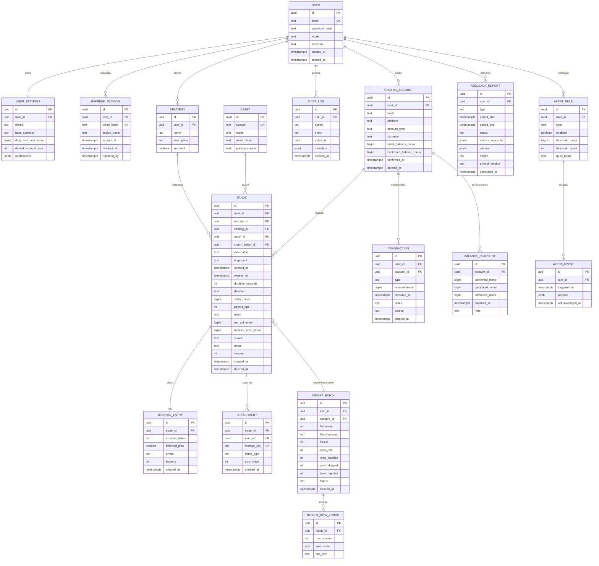

# 05 — Modelo de datos

## 1. Principios

1. **Dinero:** `BIGINT` en **unidades menores** de la divisa (céntimos). Nunca `float`/`double`.
   En la API se serializa como `string` para no perder precisión en JavaScript (`Number.MAX_SAFE_INTEGER`).
2. **Rentabilidad:** `INTEGER` en puntos básicos (`8000` = 80,00 %).
3. **Tiempo:** `TIMESTAMPTZ` en UTC. La zona IANA del usuario se guarda aparte y solo se usa para
   agrupar y mostrar.
4. **IDs:** UUIDv7 generado en el cliente o servidor (ordenable por tiempo). Sin IDs autoincrementales
   expuestos.
5. **Multi-usuario:** toda entidad de negocio tiene `userId` con FK y filtro obligatorio en repos.
6. **Borrado lógico** en operaciones y movimientos (`deletedAt`), con auditoría.
7. **Inmutabilidad del resultado:** `netPnlMinor` se calcula en el dominio al crear/editar; no se
   recalcula en cada lectura con valores que puedan haber cambiado.

## 2. Diagrama entidad-relación (entregable 7)



## 3. Diccionario de datos

### 3.1 `User`

| Campo | Tipo | Reglas |
|---|---|---|
| `id` | UUID | PK |
| `email` | CITEXT/TEXT | Único (case-insensitive), normalizado a minúsculas |
| `passwordHash` | TEXT | Argon2id; nunca se serializa |
| `locale` | TEXT | Por defecto `es`; BCP 47 |
| `timezone` | TEXT | IANA (`America/Caracas`); validado contra la base de zonas |
| `emailVerifiedAt` | TIMESTAMPTZ | Nulo si no se exige verificación |
| `createdAt`, `updatedAt` | TIMESTAMPTZ | UTC |
| `deletedAt` | TIMESTAMPTZ | Borrado de cuenta con anonimización |

### 3.2 `TradingAccount`

| Campo | Tipo | Reglas |
|---|---|---|
| `accountType` | ENUM | `REAL` \| `DEMO` (obligatorio, sin valor por defecto implícito) |
| `platform` | TEXT | `BINOMO` \| `MANUAL` \| `OTHER`; no implica integración |
| `currency` | CHAR(3) | ISO 4217; por defecto la del usuario |
| `initialBalanceMinor` | BIGINT | ≥ 0; saldo al empezar a usar la app |
| `confirmedBalanceMinor` | BIGINT | Último saldo declarado; nulo hasta la primera conciliación |
| `confirmedAt` | TIMESTAMPTZ | Fecha del saldo confirmado |
| `deletedAt` | TIMESTAMPTZ | Archivado; conserva historial |

### 3.3 `Trade`

| Campo | Tipo | Reglas |
|---|---|---|
| `accountId` | UUID | FK obligatoria, del mismo `userId` |
| `assetId` | UUID | FK al catálogo de activos (símbolo normalizado) |
| `strategyId` | UUID | Opcional |
| `externalId` | TEXT | Opcional; clave de deduplicación del origen |
| `fingerprint` | TEXT | Obligatorio cuando no hay `externalId` |
| `openedAt` | TIMESTAMPTZ | UTC, obligatorio |
| `expiresAt` | TIMESTAMPTZ | UTC; ≥ `openedAt` |
| `durationSeconds` | INTEGER | > 0; coherente con `openedAt`/`expiresAt` (±60 s de tolerancia al importar) |
| `direction` | ENUM | `CALL` \| `PUT` |
| `stakeMinor` | BIGINT | > 0 |
| `payoutBps` | INTEGER | 0–100000; 8000 = 80 % |
| `result` | ENUM | `WIN` \| `LOSS` \| `DRAW` \| `CANCELLED` \| `OPEN` |
| `netPnlMinor` | BIGINT | Calculado; negocio: ≥ −`stakeMinor` |
| `balanceAfterMinor` | BIGINT | Opcional; solo si viene del origen |
| `source` | ENUM | `MANUAL` \| `CSV` \| `XLSX` \| `API` |
| `notes` | TEXT | ≤ 2000 caracteres |
| `version` | INTEGER | Control de concurrencia optimista |
| `deletedAt` | TIMESTAMPTZ | Borrado lógico |

Restricciones:

- `UNIQUE (account_id, external_id) WHERE external_id IS NOT NULL`
- `UNIQUE (account_id, fingerprint) WHERE external_id IS NULL`
- `CHECK (stake_minor > 0)`
- `CHECK (result <> 'WIN' OR net_pnl_minor >= 0)`
- `CHECK (result <> 'LOSS' OR net_pnl_minor <= 0)`
- `CHECK (result <> 'DRAW' OR net_pnl_minor = 0)`
- `CHECK (expires_at >= opened_at)`

### 3.4 `Transaction`

| Campo | Tipo | Reglas |
|---|---|---|
| `type` | ENUM | `DEPOSIT` \| `WITHDRAWAL` \| `ADJUSTMENT` \| `COMMISSION` \| `BONUS` \| `CORRECTION` |
| `amountMinor` | BIGINT | **Siempre positivo**; el signo lo determina el tipo |
| `occurredAt` | TIMESTAMPTZ | UTC |
| `source` | ENUM | `MANUAL` \| `IMPORT` |
| `notes` | TEXT | Obligatorio en `ADJUSTMENT` y `CORRECTION` |

**No existe** una transacción de tipo “resultado de operación”: el PnL de las operaciones se suma
desde `Trade.netPnlMinor`. Esto evita la doble contabilización (BR-04).

### 3.5 `ImportBatch` / `ImportRowError`

- `fileChecksum` = SHA-256 del archivo. Si ya existe un lote con el mismo checksum **y** el usuario
  confirma “reimportar”, se permite, pero se avisa que todo será duplicado.
- `status`: `PREVIEW` \| `PROCESSING` \| `COMPLETED` \| `FAILED`.
- `rawRow` guarda la fila original como JSON **solo** para diagnóstico y se purga a los 90 días.

### 3.6 `FeedbackReport`

- `metricsSnapshot`: objeto JSON **inmutable** con las métricas usadas para generar el texto. Permite
  auditar cada afirmación.
- `content`: estructura validada (`summary`, `findings[]` con `metricRefs`, `evidence`, `confidence`,
  `caveats`), no texto libre suelto.
- `promptVersion` y `model`: obligatorios para reproducibilidad.

### 3.7 `BalanceSnapshot`

Se crea cada vez que el usuario declara un saldo confirmado. Guarda el calculado en ese instante y la
diferencia, para poder auditar conciliaciones pasadas.

## 4. Fórmulas del dominio

### 4.1 Resultado neto de una operación

```
WIN        → netPnl = round(stake × payoutBps / 10000)      (redondeo half-up a unidad menor)
LOSS       → netPnl = -stake
DRAW       → netPnl = 0
CANCELLED  → netPnl = 0
OPEN       → netPnl = 0 (no participa en métricas)
```

Ejemplo: stake 1 000 (10,00), payout 8000 (80 %) → 800 (8,00). Nunca se usa coma flotante.

### 4.2 Saldo calculado (BR-03)

Forma canónica implementada (una sola vez por concepto):

```
saldoCalculado = saldoInicial
               + depositos + bonos + ajustesConSigno
               - retiros - comisiones
               + sum(netPnl de trades con result IN (WIN, LOSS, DRAW) y deletedAt IS NULL)
```

- Las operaciones `CANCELLED` u `OPEN` no afectan al saldo.
- El resultado de una operación **no** se registra como transacción: el PnL entra únicamente por
  esta suma de `Trade.netPnlMinor`.
- El saldo confirmado **nunca** se modifica por cálculos; solo por declaración del usuario.

### 4.3 Conciliación

```
diferencia = saldoConfirmado − saldoCalculado
```

- `diferencia = 0` → conciliado.
- `0 < |diferencia| ≤ tolerancia` (tolerancia por defecto 0, configurable en ajustes en unidades
  menores) → “conciliado con diferencia tolerada”.
- `|diferencia| > tolerancia` → aviso persistente con el importe exacto y acceso a los movimientos
  del periodo. **No se corrige automáticamente.**
- Toda conciliación queda en `BalanceSnapshot` con nota opcional del usuario.

## 5. Métricas (definiciones únicas, usadas por API y móvil)

| Métrica | Fórmula | Exclusiones |
|---|---|---|
| `settledCount` | nº de operaciones con `result ∈ {WIN, LOSS, DRAW}` | `OPEN`, `CANCELLED`, borradas |
| `decidedCount` | `wins + losses` | empates, `OPEN`, `CANCELLED` |
| `winRate` | `wins / decidedCount` | si `decidedCount = 0` → `null` |
| `drawRate` | `draws / settledCount` | `null` si 0 |
| `lossRate` | `losses / decidedCount` | `null` si 0 |
| `grossProfit` | `Σ netPnl` de `WIN` | — |
| `grossLoss` | Valor absoluto de `Σ netPnl` de `LOSS` | — |
| `profitFactor` | `grossProfit / grossLoss` | si `grossLoss = 0` → `null` + etiqueta “sin pérdidas en el periodo” |
| `expectancy` | `Σ netPnl / settledCount` | `null` si 0 |
| `avgWin` / `avgLoss` | media de `netPnl` de `WIN` / `LOSS` | — |
| `largestWin` / `largestLoss` | máx / mín `netPnl` | — |
| `maxWinStreak` / `maxLossStreak` | racha máxima consecutiva por `expiresAt` | los empates **no** cortan la racha (se excluyen) |
| `maxDrawdown` | `max((peak − trough) / peak)` sobre la curva de capital | peak > 0 |
| `roiPeriodo` | `Σ netPnl / Σ stakes` | `null` si stakes = 0 |
| `avgStake` | `Σ stakes / nº operaciones` | incluye todos los resultados menos `CANCELLED` |

**Agrupaciones:** por día/semana/mes/año en la zona IANA del usuario, por activo, por hora local de
apertura, por estrategia. Cada grupo expone `n` y su nivel de muestra (BR-09).

**Curva de capital:** ordenada por `expiresAt`, parte del saldo inicial de la cuenta y aplica
`netPnl` de cada operación liquidada; los movimientos financieros se aplican por `occurredAt`.

## 6. Índices

| Tabla | Índice | Uso |
|---|---|---|
| `Trade` | `(user_id, account_id, expires_at DESC)` | Historial y series por cuenta |
| `Trade` | `(user_id, result, expires_at)` | Win rate y filtros por resultado |
| `Trade` | `(user_id, asset_id, expires_at)` | Rendimiento por activo |
| `Trade` | `(account_id, external_id)` UNIQUE parcial | Deduplicación |
| `Trade` | `(account_id, fingerprint)` UNIQUE parcial | Deduplicación sin ID |
| `Trade` | `(user_id) WHERE deleted_at IS NULL` | Listados vivos |
| `Transaction` | `(user_id, account_id, occurred_at DESC)` | Movimientos y saldo |
| `BalanceSnapshot` | `(account_id, captured_at DESC)` | Última conciliación |
| `FeedbackReport` | `(user_id, type, period_end DESC)` | Historial de informes |
| `ImportBatch` | `(user_id, created_at DESC)` | Historial de importaciones |
| `RefreshSession` | `(user_id, revoked_at)` | Revocación masiva |

Particionado: no en el MVP. Si se superan ~2 millones de operaciones, particionar `Trade` por rango
de `expires_at` (documentado como plan de crecimiento, no implementado hoy).

## 7. Migraciones y entornos

- Prisma Migrate; migraciones **versionadas y revisadas**; nunca `db push` en producción.
- `prisma migrate deploy` en el pipeline antes de arrancar el contenedor.
- Semilla de desarrollo (`seed`) con catálogo de activos y una cuenta demo de prueba; **nunca** datos
  ficticios en producción.
- Estrategia de cambio destructivo: expandir → migrar datos → contraer, en releases separados.
- Copias de seguridad: automáticas del proveedor (Neon) + export lógico mensual durante el MVP.

## 8. Espejo local en SQLite (móvil)

Tablas mínimas (subconjunto, sin secretos ni tokens):

- `trade_cache` (campos de lectura, `updated_at`, `synced_at`)
- `account_cache`, `transaction_cache`
- `dashboard_snapshot` (JSON de KPIs + marca de tiempo)
- `outbox` (Fase 5: `id`, `entity`, `operation`, `payload`, `created_at`, `attempts`, `last_error`)
- `meta` (`last_sync_at`, `schema_version`)

Migraciones locales con `PRAGMA user_version`; al cambiar el esquema, reconstrucción controlada del
espejo (los datos canónicos viven en el servidor).

## 9. Ejemplo completo de conciliación

Cuenta real, saldo inicial 100 000 (1 000,00), divisa EUR:

| Movimiento | Importe | Saldo calculado |
|---|---|---|
| Depósito | +50 000 | 150 000 |
| Operación WIN stake 10 000 @ 8000 bps | +8 000 | 158 000 |
| Operación LOSS stake 10 000 | −10 000 | 148 000 |
| Retiro | −20 000 | 128 000 |
| Comisión | −500 | 127 500 |
| Operación DRAW stake 5 000 | 0 | 127 500 |

Si el usuario declara un saldo confirmado de 127 000, la diferencia es −500 y se muestra el aviso:
“El saldo calculado difiere del confirmado en 5,00. Revisa los movimientos del periodo.”
La app **no** ajusta el saldo sola.
