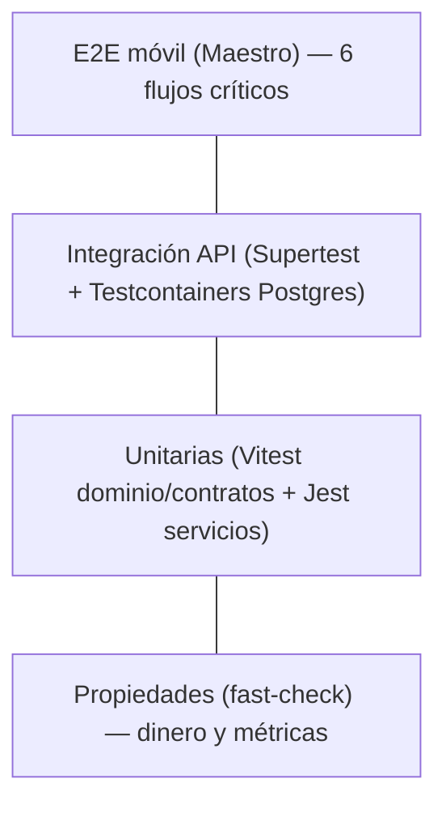

# 09 — Estrategia de pruebas

## 1. Objetivo

Detectar errores **antes** de que afecten a cifras financieras. La prioridad no es la cobertura
nominal, sino la **corrección de los cálculos**, la **integridad de los datos** y el **aislamiento
entre usuarios**.

## 2. Pirámide y responsabilidades

| Nivel | Herramienta | Qué cubre | Objetivo |
|---|---|---|---|
| Unitarias de dominio | Vitest | Money, redondeo, PnL, win rate, profit factor, rachas, drawdown, saldo | ≥ 90 % líneas y ramas |
| Propiedades | fast-check | Invariantes de dinero y agregaciones | Sin contraejemplos en 1 000 casos por propiedad |
| Unitarias API | Jest | Servicios, guards, validaciones, mapeos | ≥ 80 % en servicios críticos |
| Integración API | Jest + Supertest + Testcontainers | Endpoints reales contra Postgres real, migraciones incluidas | Todos los RF `M` |
| Contrato | Zod compartido + snapshots OpenAPI | Mismo esquema en móvil y API | 100 % de endpoints versionados |
| Componentes móvil | jest-expo + RNTL | Formularios, listas, estados vacío/error/offline | Flujos de UI críticos |
| E2E móvil | Maestro | Registro, alta de operación, importación, filtros, conciliación, feedback | 6 flujos, en Android y iOS |
| Carga | k6 | Dashboard y listado con 10 k operaciones | p95 dentro de RNF-002/003 |
| Seguridad | Tests + revisión | IDOR, rate limit, refresh reutilizado, validación, headers | Checklist de release |
| Accesibilidad | Revisión + AXE manual | Contraste, etiquetas, tamaños táctiles, fuente grande | Sin bloqueos AA |

## 3. Casos obligatorios de cálculos financieros

Tabla de escenarios que **deben** existir como pruebas automatizadas:

| # | Escenario | Resultado esperado |
|---|---|---|
| F-01 | WIN stake 1 000, payout 8000 | `netPnl = 800` |
| F-02 | WIN stake 1 000, payout 0 | `netPnl = 0` |
| F-03 | WIN stake 6, payout 7500 | Redondeo half-up exacto de 4,5: `5` |
| F-04 | WIN stake 1, payout 1 | `0` (half-up de 0,0001) |
| F-05 | LOSS stake 1 000, payout 8000 | `netPnl = -1000` (el payout no aplica) |
| F-06 | DRAW stake 1 000 | `0` y no altera saldo |
| F-07 | CANCELLED stake 1 000 | `0`, excluida de win rate y expectativa |
| F-08 | OPEN | `0`, excluida de todas las métricas |
| F-09 | Importe máximo permitido (BIGINT seguro) | Sin desbordamiento ni pérdida de precisión |
| F-10 | Suma de 10 000 operaciones | Igual a suma entera exacta |
| F-11 | Win rate con 0 decididas | `null`, no `0` |
| F-12 | Profit factor sin pérdidas | `null` + etiqueta |
| F-13 | Profit factor con pérdidas | Cociente exacto con 4 decimales en UI |
| F-14 | Expectativa con empates | Denominador = liquidadas, incluidos empates |
| F-15 | Racha con empates intercalados | Los empates no cortan la racha |
| F-16 | Drawdown con nuevo máximo | Reinicia el pico correctamente |
| F-17 | Drawdown sin caída | `0`, no `null` |
| F-18 | Saldo: depósito + WIN + LOSS + retiro + comisión | Coincide con el ejemplo de `05` |
| F-19 | PnL no contabilizado dos veces | Saldo no cambia al “registrar resultado” |
| F-20 | Operación borrada lógicamente | Excluida de saldo y métricas |
| F-21 | Cuenta demo | Excluida de indicadores globales |
| F-22 | Agrupación en DST (23/25 h) | Día con 23/25 horas correcto |
| F-23 | Agrupación en zona +05:30 / +05:45 | Corte de día correcto |
| F-24 | Cambio de mes/año en UTC vs local | El grupo corresponde al día local |
| F-25 | Dos divisas en cuentas distintas | Sin suma cruzada; se informa por cuenta |
| F-26 | Importación repetida 3 veces | Mismo estado, cero duplicados |
| F-27 | Mismo `externalId` en cuentas distintas | Permitido |
| F-28 | Huella igual por coincidencia | Se marca duplicado y se pide revisión |

## 4. Pruebas de importación

- **Fixtures versionados** en `packages/testing/fixtures/imports/`:
  - CSV con BOM, `;`, coma decimal, `dd/mm/yyyy`.
  - CSV sin encabezados.
  - XLSX con hoja múltiple (se usa la primera y se avisa).
  - Fila con fecha inválida, importe negativo, payout > 100 %, duración 0.
  - Archivo con 10 001 filas (rechazo por límite).
  - Archivo con caracteres acentuados y saltos Windows.
- **Propiedades:** importar un archivo y exportar el mismo conjunto produce filas equivalentes
  (salvo orden e IDs).
- **Seguridad:** archivo con fórmula de Excel (`=cmd|...`) tratado como texto, nunca ejecutado;
  CSV con celdas de 1 MB rechazado; path traversal en nombre de archivo neutralizado.

## 5. Pruebas de API y seguridad

| Prueba | Criterio |
|---|---|
| IDOR | Usuario A no puede leer/editar/borrar recursos de B (404, no 403, para no filtrar existencia) |
| Token | Expirado, firma inválida, `alg: none`, audiencia incorrecta → 401 |
| Refresh | Reutilización revoca la cadena completa |
| Rate limit | 429 tras el límite; cabeceras de reintento |
| Validación | Payload con campos extra, tipos incorrectos, importes negativos, enums inválidos → 422 con `details` |
| Idempotencia | Dos POST con la misma clave → un recurso y la misma respuesta |
| Paginación | Cursor inválido → 400; sin duplicados ni saltos |
| Archivos | Tamaño, MIME y extensión verificados en servidor |
| IA | El payload enviado no contiene `email`, `notes`, `journal`, `attachment`, `accountId` |
| IA (proveedor) | En CI se usa un mock con el mismo contrato; `AI_ENABLED=false` no produce ninguna petición; 429 y JSON inválido degradan a resumen determinista |
| Logs | Ningún importe, nota, token o correo en logs de prueba |

## 6. Pruebas de rendimiento

| Escenario | Datos | Objetivo |
|---|---|---|
| `GET /v1/analytics/summary` | 10 000 operaciones, 1 usuario | p95 ≤ 400 ms |
| `GET /v1/trades` primera página | 100 000 operaciones | p95 ≤ 300 ms |
| `POST /v1/trades` | 50 req/s concurrentes | p95 ≤ 250 ms, sin duplicados |
| Importación 10 000 filas | 1 archivo | ≤ 20 s, transaccional |
| Arranque móvil | 500 operaciones cacheadas | ≤ 2 s en gama media |
| Scroll de historial | 1 000 filas | 60 fps sin caídas > 100 ms |

## 7. Datos de prueba

- **Nunca** datos reales del usuario en pruebas.
- Fixtures deterministas con `faker` sembrado (semilla fija) en `packages/testing`.
- Base de datos efímera por ejecución (Testcontainers); sin estado compartido entre pruebas.
- Prohibido usar producción para pruebas; staging con datos sintéticos.

## 8. Puertas de CI (bloqueantes)

1. `lint` y `format:check`.
2. `typecheck` en todos los paquetes.
3. `test:domain` (Vitest + fast-check) con cobertura ≥ 90 %.
4. `test:api` (Jest + Testcontainers) con migraciones aplicadas desde cero.
5. `test:contracts` (Zod + OpenAPI sin cambios inesperados).
6. `test:mobile` (jest-expo) en componentes críticos.
7. `audit` (sin vulnerabilidades altas/críticas sin justificación) y `gitleaks`.
8. `build` de API y `expo export` del móvil.
9. `madge --circular` sin ciclos.

E2E con Maestro y pruebas de carga se ejecutan en la rama principal y antes de cada release
(no en cada PR, por coste y tiempo).

## 9. Definición de “prueba suficiente” para un PR

- Cambia lógica de dominio → prueba unitaria + propiedad.
- Cambia un endpoint → prueba de integración con caso feliz y al menos dos errores.
- Cambia UI con datos → prueba de componente para carga, vacío y error.
- Cambia esquema → migración + prueba de migración desde cero + actualización de `05`.
- Cambia contrato → actualización de `packages/contracts` + OpenAPI + cliente.

## 10. Gestión de fallos

- Un test que falla no se desactiva: se corrige el código o se documenta el defecto con issue.
- No se permite `skip`/`only` en la rama principal; un lint personalizado lo bloquea.
- Los fallos intermitentes se investigan; si son de infraestructura, se aísla el test y se registra
  el riesgo, no se silencia.
- Todo bug de cálculo corregido genera primero un test que lo reproduce.
