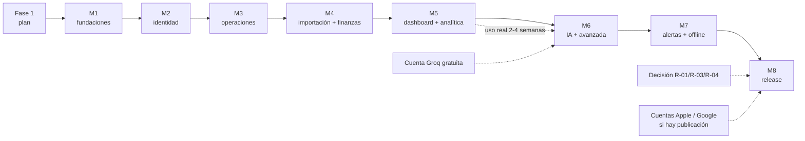

# 11 — Roadmap de implementación

## 1. Enfoque

- Entrega **por hitos verticales**: cada hito termina con algo usable, no con capas a medias.
- Un hito no se cierra sin pruebas, documentación y criterios de salida cumplidos.
- Estimaciones en **semanas de trabajo efectivo** de un desarrollador senior asistido por IA,
  incluyendo pruebas y documentación. No incluyen esperas de revisión de tiendas.
- El orden puede ajustarse, pero las dependencias marcadas son obligatorias.

```
Fase 1  ████  (completada)
M1      ██████
M2      ████
M3      ████████
M4      ██████
M5      ████████
M6      █████████
M7      ████████
M8      ████████
```

## 2. Hitos

### Fase 1 — Análisis y planificación ✅
**Duración:** 1 semana · **Estado:** completada y aprobada (2026-11-21).
**Entregables:** esta carpeta `docs/`.
**Salida:** usuario aprueba el plan (y decide sobre R-01/R-03/R-04).

---

### M1 — Fundaciones (Fase 2) ✅
**Duración:** 2 semanas · **Depende de:** aprobación de Fase 1. · **Estado:** completado (2026-11-22).

Implementado y verificado: monorepo pnpm/Turborepo, TypeScript estricto, ESLint/Prettier, husky,
CI con Postgres y gitleaks; `packages/domain` con dinero, PnL, saldo y métricas (55 pruebas,
cobertura 99 %); `packages/contracts` (Zod) y `packages/testing`; API NestJS con `/health`,
`/health/ready`, OpenAPI, errores con `requestId` y logs con scrubbing; esquema Prisma de 17 tablas,
migración con CHECKs aplicada en Postgres 16; app Expo con Router, tema, i18n y 15 componentes de UI,
con bundle Android generado con Metro.

Pendiente para cerrar el hito al 100 %: kit de 15 componentes y build instalable en dispositivo
(requiere EAS o un equipo con Android Studio/Xcode).

- [x] Monorepo pnpm + Turborepo, tsconfig base, ESLint/Prettier, husky/lint-staged.
- [x] `packages/domain` (Money, PnL, saldo, métricas) + `packages/contracts` + `packages/testing`.
- [x] API NestJS mínima: config validada, `/health`, `/health/ready`, errores, logs con scrubbing,
      OpenAPI. Sentry queda para M8 (no se ha contratado nada).
- [x] Prisma + PostgreSQL en Docker Compose; migración inicial aplicada y verificada.
- [x] Proyecto Expo con Expo Router, tema, tokens e i18n base y **15 componentes**: Screen,
      AppText, Card, Button, Badge, StateView, Input, Divider, ListRow, StatTile, SectionHeader,
      Chip, Toggle, ProgressBar y Skeleton.
- [x] CI: lint, typecheck, tests, build, gitleaks.
- [ ] EAS `development` configurado y primer build instalado en dispositivo físico (pendiente:
      requiere cuenta EAS y un dispositivo; no verificable en este entorno Windows).

**Salida:** `pnpm lint && pnpm typecheck && pnpm test && pnpm build` en verde; migración aplicada en
un Postgres limpio; API respondiendo `/health` y `/health/ready` contra la base real; bundle Android
generado con Metro. La instalación en dispositivo queda pendiente de EAS.

---

### M2 — Identidad, cuentas y ajustes (Fase 3)
**Duración:** 1,5 semanas · **Depende de:** M1.

- Registro, login, refresh rotativo, revocación, cambio de contraseña, rate limits.
- Sesiones por dispositivo y auditoría.
- Onboarding con disclaimer y detección de zona horaria.
- CRUD de cuentas real/demo + saldo inicial como movimiento de apertura.
- Ajustes: tema, zona horaria, divisa, idioma (solo es).

**Salida:** un usuario puede crear cuenta, iniciar sesión, crear su cuenta real y verla tras
reiniciar la app. Pruebas de seguridad de IDOR y refresh.

---

### M3 — Operaciones, diario e historial (Fase 3)
**Duración:** 2 semanas · **Depende de:** M2.

- Formulario rápido con precarga, cálculo en vivo, validaciones compartidas.
- Deduplicación, idempotencia, edición con versión, borrado con deshacer.
- Diario de texto por operación con borrador local.
- Historial: filtros combinables, paginación por cursor, indicadores visuales accesibles.
- Detalle con contexto y auditoría.

**Salida:** 50 operaciones registradas en un dispositivo real; duplicados bloqueados; tiempo medio
de alta ≤ 45 s medido con 10 registros.

---

### M4 — Importación y control financiero (Fase 3)
**Duración:** 2 semanas · **Depende de:** M3.

- Importador CSV/XLSX: detección, mapeo, perfiles, vista previa, transacción, informe y errores.
- Movimientos: depósitos, retiros, comisiones, bonos, ajustes, correcciones.
- Saldo calculado, confirmado, conciliación y desglose enlazado.
- Exportación CSV filtrada.

**Salida:** archivo real de 500+ filas importado y conciliado contra el saldo del bróker; reimportar
tres veces no altera el estado; saldo coincide con el ejemplo de `05`.

---

### M5 — Dashboard y analítica núcleo (Fase 3)
**Duración:** 2 semanas · **Depende de:** M4.

- Endpoints de resumen y series con agregación SQL e índices.
- 13 indicadores, filtros globales, nivel de muestra y ayudas de fórmula.
- Gráficos: capital, ganancias/pérdidas, distribución, por activo.
- Caché de lectura offline (SQLite) con marca temporal y banner sin conexión.
- Pruebas de rendimiento con 10 000 operaciones.

**Salida:** MVP completo según `10`; criterios de salida del MVP cumplidos; build de preview
distribuido para uso real durante 2–4 semanas.

---

### M6 — Analítica avanzada, diario completo y feedback IA (Fase 4)
**Duración:** 2,5 semanas · **Depende de:** M5 + alta de la cuenta gratuita de Groq (0 USD, sin tarjeta).

- Profit factor, expectativa, rachas, drawdown, ROI, distribución de riesgo.
- Rendimiento por hora (mapa de calor) y por estrategia; comparativas de periodo.
- Adjuntos privados con URL firmada, compresión y sin EXIF.
- Filtros del diario por error/disciplina.
- Motor de feedback: métricas → prompt → validación de esquema y cifras → informe almacenado.
- Proveedor: Groq nivel gratuito (`openai/gpt-oss-120b`, JSON estricto), con ZDR activado y reserva en
  Cloudflare Workers AI.
- Límites, caché, degradación a resumen determinista y pruebas anti-alucinación.

**Salida:** informes diario/semanal/mensual con evidencias verificables; ninguna cifra puede diferir
del snapshot; payload auditado sin PII.

---

### M7 — Alertas, reportes y endurecimiento (Fase 5)
**Duración:** 2 semanas · **Depende de:** M6.

- Reglas de alerta y notificaciones locales; resúmenes programados; silencio.
- Bloqueo local PIN/biometría; escritura offline con outbox e idempotencia.
- Exportación completa ZIP y borrado de cuenta con gracia.
- Reportes PDF (si el uso lo justifica), mejoras de rendimiento y accesibilidad.

**Salida:** uso diario sin pérdida de datos con red intermitente; alertas informativas sin lenguaje
de “recuperar pérdidas”.

---

### M8 — Finalización y entrega (Fase 6)
**Duración:** 1,5 semanas · **Depende de:** M7.

- Revisión completa de seguridad y privacidad; checklist de `12`.
- Pruebas E2E en dispositivos; corrección de defectos.
- Builds de producción Android/iOS; firma; versionado.
- Publicación interna/TestFlight y, si se autoriza, revisión de tiendas con metadatos y política de
  privacidad.
- Documentación de instalación, despliegue, mantenimiento y runbook de incidentes.

**Salida:** release 1.0 instalable y documentado; riesgos residuales aceptados por escrito.

## 3. Cronograma estimado

| Hito | Semanas | Acumulado |
|---|---|---|
| Fase 1 | 1 | 1 |
| M1 | 2 | 3 |
| M2 | 1,5 | 4,5 |
| M3 | 2 | 6,5 |
| M4 | 2 | 8,5 |
| M5 | 2 | 10,5 |
| M6 | 2,5 | 13 |
| M7 | 2 | 15 |
| M8 | 1,5 | 16,5 |

**Total estimado: ~16,5 semanas** de trabajo efectivo (≈ 4 meses de calendario con holgura).
El MVP (hasta M5) queda en **~10,5 semanas**.

## 4. Dependencias y camino crítico



Camino crítico: **Fase 1 → M1 → M3 → M4 → M5 → M6 → M8**. M2 puede solaparse parcialmente con M1
en diseño de UI.

## 5. Riesgos de calendario

| Riesgo | Impacto | Margen previsto |
|---|---|---|
| Configuración de build iOS (cuenta Apple, certificados) | +1 semana | Iniciar en M1, no en M8 |
| Formato real de archivos del bróker desconocido | +1 semana | Importador genérico con mapeo manual desde M4 |
| Revisión de tiendas | +1–3 semanas | Distribución interna primero; no bloquea el MVP |
| Cambios de requisitos | Variable | Congelar alcance por hito; extras al backlog |

## 6. Próximos pasos inmediatos (tras aprobación)

1. Confirmar las decisiones abiertas (ver `12`, sección 5).
2. Inicializar el monorepo y la CI (M1) — **sin** crear cuentas de servicios de pago.
3. Configurar `docker-compose` con PostgreSQL y ejecutar la primera migración.
4. Implementar `packages/domain` con pruebas F-01…F-08 antes de tocar la UI.
5. Instalar el primer build en un dispositivo real y validar el flujo vacío.
